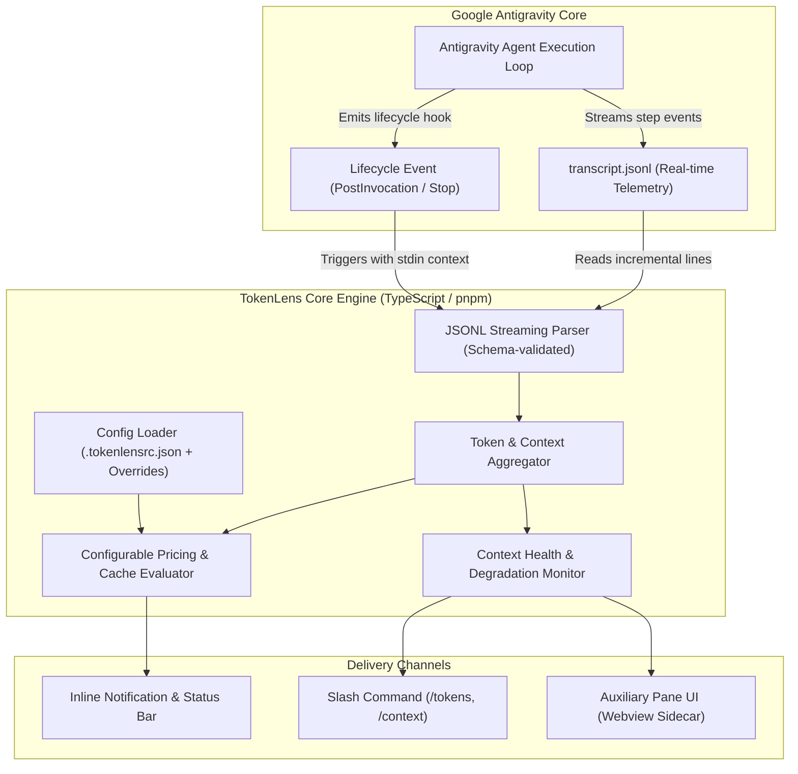

# TokenLens: Architectural Blueprint & Engineering Specification

> Real-time token analytics, cost intelligence, and context degradation monitor for Google Antigravity.

---

## 1. Executive Summary & Vision

Modern AI-assisted IDEs empower developers through autonomous multi-step agent loops. However, agentic workflows generate significant hidden overhead:
1. **Unpredictable Cost Spikes:** A single autonomous debugging session can execute dozens of tool calls and inspect thousands of lines of code, quickly consuming hundreds of thousands of tokens.
2. **Context Degradation & Hallucinations:** As context size expands beyond optimal boundaries, large language models (LLMs) suffer from attention dilution ("lost in the middle"), leading to hallucinated file paths, degraded code quality, and infinite tool loops.

**TokenLens** is an open-source Antigravity plugin and developer telemetry tool designed to provide transparent, real-time observability over token consumption, financial cost, and context window saturation.

---

## 2. Security Architecture & Threat Model

Security is a primary design pillar for TokenLens. Because this tool inspects development workflows, it enforces strict boundaries:

### 2.1 Zero External Transmission (Air-Gapped Operation)
- All log parsing, aggregation, and cost calculations are performed 100% locally in-process.
- No telemetry, prompt tokens, code snippets, or usage statistics are transmitted across the network.
- Outbound network calls are completely disabled in core analysis modules.

### 2.2 Transcript & Content Sanitization
- Although Antigravity logs token counts per step, user prompts and tool outputs can contain sensitive code, passwords, or environment variables.
- The TokenLens core engine strictly extracts numeric metadata (`input_tokens`, `output_tokens`, `cache_read_tokens`, `model`) and ignores arbitrary code text unless the user explicitly requests prompt size profiling.
- Content strings are never written to external files or exposed outside the local session.

### 2.3 Dependency Isolation & Supply Chain Security
- **Package Manager Choice: `pnpm`**
  - Standard `npm` uses a flat, hoisted `node_modules` structure where packages can access dependencies they did not explicitly declare ("phantom dependencies"). This creates supply-chain attack vectors.
  - `pnpm` creates a content-addressable store with strict symlink-based isolation. Packages can only access the exact dependencies defined in their `package.json`, neutralizing phantom dependency risks.
- Strict lockfile enforcement (`pnpm-lock.yaml`) and automated vulnerability auditing.

### 2.4 Input Validation & Path Traversal Prevention
- Configuration files (`.tokenlensrc.json`) and transcript paths are verified against path traversal attacks.
- File paths are strictly resolved within workspace boundaries.
- All JSON and JSONL structures are validated using typed schemas to prevent prototype pollution and malformed payload crashes.

---

## 3. System Architecture



---

## 4. Core Modules & Component Design

### 4.1 `token-lens-core` (Data Processing Engine)
- **Streaming Log Ingestion:** Parses `transcript.jsonl` efficiently without loading the entire multi-megabyte log into memory.
- **Metrics Aggregation:**
  - `input_tokens` (System instructions, tools, conversation history, workspace files)
  - `output_tokens` (Model reasoning, plan, tool calls)
  - `cache_read_tokens` (Prompt cache hits)
  - `turn_duration_ms` & `step_count`
- **Configurable Pricing Engine:**
  - **Default Rates:** Built-in standard rates per 1M tokens for major providers (Gemini, Claude, OpenAI, local models).
  - **User Overrides:** Fully editable via `.tokenlensrc.json` or workspace settings. Users can define custom models, custom input/output/cache rates, enterprise discount percentages, or fixed rate cards.
  - **Formula:**
    $$\text{Cost} = \frac{(\text{input\_tokens} - \text{cache\_read\_tokens}) \times \text{InputPrice}}{10^6} + \frac{\text{cache\_read\_tokens} \times \text{CachePrice}}{10^6} + \frac{\text{output\_tokens} \times \text{OutputPrice}}{10^6}$$
- **Context Health Evaluator:**
  - Computes context window utilization against model maximum limits.
  - Categorizes context health:
    - [Optimal] Below 40% capacity: High attention and instruction fidelity.
    - [Caution] 40% to 70% capacity: Minor attention drift possible; cache optimization recommended.
    - [Degraded] Above 70% capacity: Elevated risk of hallucination and repetition. Compaction suggested.

### 4.2 User Configuration Schema (`.tokenlensrc.json`)

To ensure full user control over costs, the user can place a `.tokenlensrc.json` file in their workspace or home directory:

```json
{
  "currency": "USD",
  "budgetLimit": 5.00,
  "alertThresholdPercent": 65,
  "models": {
    "gemini-3.8-flash-high": {
      "inputPricePerMillion": 0.15,
      "outputPricePerMillion": 0.60,
      "cacheReadPricePerMillion": 0.0375,
      "contextWindowLimit": 1048576
    },
    "custom-enterprise-claude": {
      "inputPricePerMillion": 2.40,
      "outputPricePerMillion": 12.00,
      "cacheReadPricePerMillion": 0.24,
      "contextWindowLimit": 200000
    },
    "local-llama": {
      "inputPricePerMillion": 0.00,
      "outputPricePerMillion": 0.00,
      "cacheReadPricePerMillion": 0.00,
      "contextWindowLimit": 131072
    }
  }
}
```

### 4.3 `token-lens-plugin` (Antigravity Integration)
- **`hooks.json` Configuration:**
  - Binds to `PostInvocation` to process token telemetry after each agent turn.
  - Binds to `Stop` to summarize session-wide metrics when an agent terminates.
- **Slash Commands & Skills:**
  - `/tokens`: Outputs a clean tabular breakdown of tokens per turn and total expenditure.
  - `/context`: Visualizes current context saturation, breakdown of tokens, and actionable compaction guidance.

### 4.4 `token-lens-ui` (Auxiliary Pane Sidecar)
- An interactive web panel hosted as an Antigravity Sidecar (`has_web_ui: true`, `entrypoint: SIDECAR_UI_ENTRYPOINT_AUX_PANE`).
- **Visual Features:**
  - **Context Saturation Gauge:** Progress meter displaying remaining tokens before model limit.
  - **Cost Ticker:** Cumulative session cost updated live.
  - **Token Burn Rate Chart:** Step-by-step bar chart illustrating token deltas per tool execution.
  - **Settings Panel:** Direct in-UI configuration allowing the user to update their rates and model targets without manual file editing.

---

## 5. Technology Stack

| Layer | Technology | Rationale |
| :--- | :--- | :--- |
| **Package Manager** | `pnpm` | Strict dependency isolation, immune to phantom dependency supply chain vulnerabilities |
| **Language** | TypeScript (Node.js 20+) | Static typing, strong standard library integration, IDE-native execution |
| **Build System** | `tsup` | Minimal footprint, fast compilation to dual ESM/CJS |
| **Testing** | `vitest` | Fast unit and integration testing with native ESM support |
| **Linting & Formatting** | `eslint` + `prettier` | Strict security linting rules (`eslint-plugin-security`) |
| **UI Sidecar** | React 19 + Tailwind CSS + Vite | Zero external runtime calls, lightweight client-side rendering |
| **CI/CD** | GitHub Actions | Automated lint, dependency audit, and test execution |

---

## 6. Implementation Roadmap

### Phase 1: Core Engine & Testing
- Define TypeScript schemas for configuration, model catalogs, and `transcript.jsonl` events.
- Implement `.tokenlensrc.json` loader with validation and default fallback catalog.
- Build streaming JSONL parser and token aggregation logic.
- Target over 90% unit test coverage.

### Phase 2: Antigravity Plugin & Hook Integration
- Configure `hooks.json` listening to `PostInvocation`.
- Build lightweight CLI output reporting token and cost deltas after each turn.
- Create `/tokens` and `/context` slash command skills.

### Phase 3: Sidecar UI & Visual Polish
- Scaffold Vite + React sidecar configured with `sidecar.json`.
- Implement responsive context gauge, cost metrics, and user rate configuration panel.

### Phase 4: Release & Portfolio Showcasing
- Comprehensive `README.md` with technical architectural documentation and setup instructions.
- GitHub Actions CI workflow with automated security audits (`pnpm audit`).
