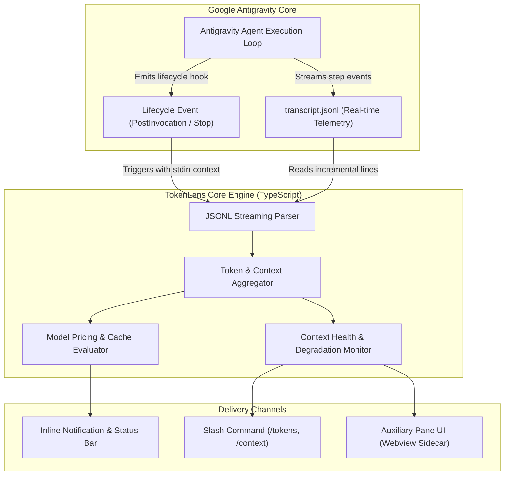
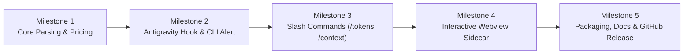

# TokenLens: Architectural Blueprint & Engineering Specification

> **Real-time token analytics, cost intelligence, and context degradation monitor for Google Antigravity.**

---

## 1. Executive Summary & Vision

Modern AI-assisted IDEs empower developers through autonomous multi-step agent loops. However, agentic workflows generate significant hidden overhead:
1. **Unpredictable Cost Spikes:** A single autonomous debugging session can execute dozens of tool calls and inspect thousands of lines of code, quickly consuming hundreds of thousands of tokens.
2. **Context Degradation & Hallucinations:** As context size expands beyond optimal boundaries, large language models (LLMs) suffer from attention dilution ("lost in the middle"), leading to hallucinated file paths, degraded code quality, and infinite tool loops.

**TokenLens** is an open-source Antigravity plugin and developer telemetry tool designed to provide transparent, real-time observability over token consumption, financial cost, and context window saturation.

---

## 2. System Architecture

---

## 3. Core Modules & Component Design

### 3.1 `token-lens-core` (Data Processing Engine)
- **Streaming Log Ingestion:** Parses `transcript.jsonl` efficiently without loading the entire multi-megabyte log into memory.
- **Metrics Aggregation:**
  - `input_tokens` (System instructions, tools, conversation history, workspace files)
  - `output_tokens` (Model reasoning, plan, tool calls)
  - `cache_read_tokens` (Prompt cache hits)
  - `turn_duration_ms` & `step_count`
- **Pricing Catalog:** Configurable pricing table mapping models to rates per 1M tokens:
  - Gemini 2.0 Flash / Gemini 1.5 Pro
  - Claude 3.5 Sonnet / Claude 3.7 Sonnet / Claude 3 Opus
  - GPT-4o / GPT-4o-mini
  - Custom / Local models (Ollama, vLLM: $0.00)
- **Health Evaluator:**
  - Computes context window utilization against model maximum limits.
  - Categorizes context health:
    - 🟢 **Optimal (< 40% capacity):** Peak attention and instruction fidelity.
    - 🟡 **Caution (40% - 70% capacity):** Minor attention drift possible; cache optimization recommended.
    - 🔴 **Degraded (> 70% capacity):** High risk of hallucination and loop repetition. Compaction suggested.

### 3.2 `token-lens-plugin` (Antigravity Integration)
- **`hooks.json` Configuration:**
  - Binds to `PostInvocation` to process token telemetry after each agent turn.
  - Binds to `Stop` to summarize session-wide metrics when an agent terminates.
- **Slash Commands & Skills:**
  - `/tokens`: Outputs a clean tabular breakdown of tokens per turn and total expenditure.
  - `/context`: Visualizes current context saturation, breakdown of tokens (files vs. chat history), and provides actionable compaction guidance.

### 3.3 `token-lens-ui` (Auxiliary Pane Sidecar)
- An interactive web panel hosted as an Antigravity Sidecar (`has_web_ui: true`, `entrypoint: SIDECAR_UI_ENTRYPOINT_AUX_PANE`).
- **Visual Features:**
  - **Context Saturation Gauge:** Radial progress meter displaying remaining tokens before model limit.
  - **Cost Ticker:** Cumulative session cost updated live.
  - **Token Burn Rate Chart:** Step-by-step bar chart illustrating token deltas per tool execution.
  - **Composition Breakdown:** Pie chart dividing context between tools, system prompt, conversation history, and user input.

---

## 4. Technology Stack

| Layer | Technology | Rationale |
| :--- | :--- | :--- |
| **Language** | TypeScript (Node.js 20+) | Type safety, native ecosystem for VS Code and Antigravity tooling |
| **Build System** | `tsup` / `esbuild` | Zero-config, ultra-fast compilation to dual ESM/CJS |
| **Testing** | `vitest` | Blazing-fast unit and integration testing with native ESM support |
| **Linting & Formatting** | `biome` or `eslint` + `prettier` | Consistent code style and high engineering standards |
| **UI Sidecar** | React 19 + Tailwind CSS + Vite | Lightweight, fast rendering inside Antigravity's webview |
| **CI/CD** | GitHub Actions | Automated lint, build, test matrix on push and PR |

---

## 5. Engineering Implementation Roadmap

### Phase 1: Core Engine & Testing
- Define TypeScript schemas for `transcript.jsonl` events (`PLANNER_RESPONSE`, `USER_INPUT`, `GENERIC`).
- Implement streaming JSONL parser and token aggregation logic.
- Build pricing model engine with tests covering cache hits vs. misses.
- Target > 90% unit test coverage.

### Phase 2: Antigravity Plugin & Hook Integration
- Configure `hooks.json` listening to `PostInvocation`.
- Build lightweight CLI output reporting token and cost deltas after each turn.
- Create `/tokens` and `/context` slash command skills.

### Phase 3: Sidecar UI & Visual Polish
- Scaffold Vite + React sidecar configured with `sidecar.json`.
- Implement responsive context gauge and cost metrics.
- Support live polling or IPC message updates from the core hook.

### Phase 4: Release & Portfolio Showcasing
- Comprehensive `README.md` with GIFs, architectural diagrams, and installation guide.
- GitHub Actions CI badge, code coverage report, and automated release tags.
