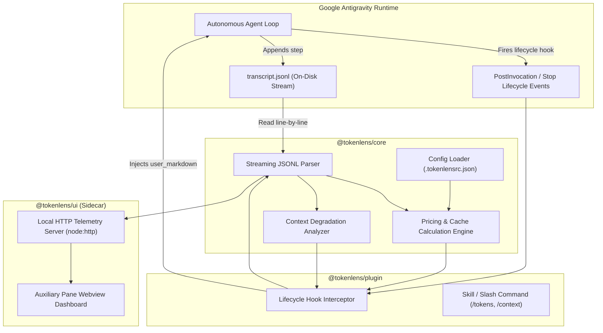

# TokenLens

> Real-time token analytics, cost intelligence, and context degradation monitor for Google Antigravity.

---

## Overview

TokenLens is a developer observability plugin and telemetry engine designed for Google Antigravity. As autonomous agent loops read codebases and execute tools, context size expands and token usage grows rapidly. TokenLens provides transparent, local observability into:

- **Context Saturation & Attention Health:** Real-time capacity monitoring with threshold alerts to prevent instruction forgetting and model hallucination.
- **Prompt Caching Efficiency:** Accurate tracking of cached prompt tokens versus new generation deltas.
- **Compute Valuation:** Real-time valuation of API compute against standard provider rate cards, while distinguishing paid consumption from included Antigravity subscription quotas.
- **Turn-by-Turn Telemetry:** Granular step metrics for both inline terminal logs and an interactive sidecar dashboard.

---

## System Architecture



---

## Monorepo Packages

The repository is structured as a `pnpm` workspace containing three decoupled packages:

| Package | Path | Description |
| :--- | :--- | :--- |
| **`@tokenlens/core`** | `packages/core` | Core telemetry parser, model pricing catalog, and context health algorithms. Zero external runtime dependencies. |
| **`@tokenlens/plugin`** | `packages/plugin` | Antigravity plugin manifest, `hooks.json` lifecycle interceptors, and slash command skills. |
| **`@tokenlens/ui`** | `packages/ui` | Lightweight HTTP telemetry server and self-contained webview dashboard designed for Antigravity's Auxiliary Pane sidecar. |

---

## Security Architecture

TokenLens is designed under a zero-trust, security-first model:

- **Air-Gapped Operation:** All log parsing, aggregation, and cost estimation executes 100% locally in-process. Outbound network transmission is completely absent.
- **Data Sanitization:** The engine parses numeric step metadata (`input_tokens`, `output_tokens`, `cache_read_tokens`, `model`) and ignores code snippets, environment variables, or prompt text.
- **Supply-Chain Sandboxing:** Managed via `pnpm` with strict dependency isolation. Build scripts from dependencies are blocked by default and audited to protect against supply-chain compromise.
- **Path Traversal Defense:** All transcript and configuration file resolution is validated within strict filesystem boundaries.

---

## Getting Started

### Prerequisites

- Node.js 20.x or 22.x
- `pnpm` (version 12.x recommended)

### Installation

Clone the repository and install workspace dependencies:

```bash
git clone https://github.com/R-FS/Token-lens.git
cd Token-lens
pnpm install
```

### Build

Compile all packages (generates dual ESM/CJS bundles and type declarations):

```bash
pnpm build
```

### Running Tests

Execute the automated test suite across all packages:

```bash
pnpm test
```

### Static Typechecking

Verify TypeScript types across the monorepo:

```bash
pnpm typecheck
```

---

## Configuration

TokenLens provides authoritative pricing defaults for common frontier models (Gemini 2.0 Flash, Gemini 1.5 Pro, Claude 3.5/3.7 Sonnet, GPT-4o, etc.). 

To define custom model rates, enterprise discounts, or budget limits, create a `.tokenlensrc.json` file in your workspace root:

```json
{
  "currency": "USD",
  "budgetLimitUsd": 15.00,
  "alertThresholdPercent": 70,
  "models": {
    "gemini-3.8-flash-high": {
      "inputPricePerMillion": 0.15,
      "outputPricePerMillion": 0.60,
      "cacheReadPricePerMillion": 0.0375,
      "contextWindowLimit": 1048576
    },
    "custom-local-model": {
      "inputPricePerMillion": 0.00,
      "outputPricePerMillion": 0.00,
      "cacheReadPricePerMillion": 0.00,
      "contextWindowLimit": 131072
    }
  }
}
```

See [.tokenlensrc.example.json](./.tokenlensrc.example.json) for a complete template.

---

## Usage in Antigravity

### 1. Inline Telemetry Notifications
Once installed in an Antigravity workspace or plugin directory, TokenLens automatically hooks into `PostInvocation`. At the end of each model turn, an inline notification indicates:

```text
[TokenLens] Turn 14: +3,480 tokens ($0.0035) | Total: 48,200 tokens ($0.0420) | Cache: 94.8% | Context: 4.6% [OPTIMAL]
```

If context saturation exceeds your configured threshold (default: 70%), a warning alert is appended recommending compaction.

### 2. Slash Commands
Developers can query session metrics on demand using the `/tokens` or `/context` slash commands to output a turn-by-turn markdown table.

### 3. Auxiliary Pane Sidecar
The visual webview dashboard can be opened inside Antigravity's Auxiliary (side) Pane, updating every 2.5 seconds with:
- Live context memory saturation gauge.
- Commercial compute value versus billed quota.
- Cache hit percentage.
- Scrollable turn history with step costs.

---

## License

Apache-2.0
